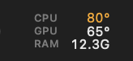
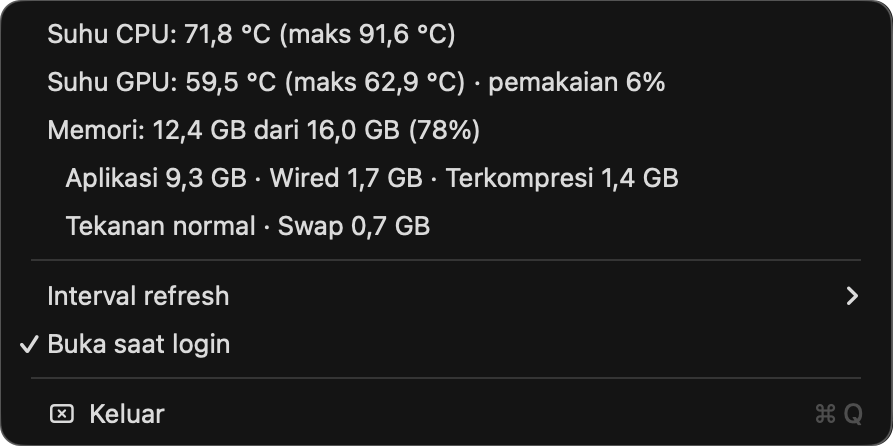

# Hardware Monitor

**English** | [Bahasa Indonesia](README.id.md)



*CPU, GPU, and RAM in the menu bar (dark mode, CPU at the 80 °C warning threshold).*



*Details menu: average/max temperatures, GPU usage, memory breakdown, refresh interval, and open at login.*

A lightweight macOS menu bar app for monitoring CPU temperature, GPU temperature, and memory usage on Apple Silicon.

The menu bar shows CPU, GPU, and RAM stacked in a single column about 55 pt wide
(9 pt font; 8 pt on a 24 pt menu bar). Temperatures turn orange at ≥ 80 °C and red at ≥ 95 °C,
and RAM changes color when memory pressure is high. Click it for details: average/max temperatures, GPU usage,
memory breakdown, swap, and refresh interval (1/2/5 seconds). Move it with ⌘-drag.

> The app's menu text is currently in Indonesian.

## Requirements

- Mac with Apple Silicon (tested on M2)
- macOS 14 or later
- Swift 5.9+ (Xcode Command Line Tools are enough; full Xcode is not required)

The app reads sensors through private APIs (AppleSMC and IOHIDEventSystem), so it is unsandboxed and
cannot be distributed through the Mac App Store.

## Build & install

```bash
./scripts/install.sh    # build, replace /Applications/Hardware Monitor.app, then launch
./scripts/bundle.sh     # build only → build/Hardware Monitor.app
```

To start automatically after login, check **Buka saat login** ("Open at login") in the app's menu
(uses `SMAppService`; also visible under System Settings → General → Login Items).
Enable it from the copy in `/Applications`, because macOS registers the location of the running app.
The app is ad-hoc signed, so after reinstalling a new build you may need to toggle this option again.

## Sensor validation

Temperature readings outside 10–130 °C, or more than 25 °C below the median of their group, are discarded;
that key keeps its last valid value. After the Mac wakes from sleep, readings are paused for 5 seconds
and then every key is read again. Discarded readings are logged:

```bash
log show --last 1d --predicate 'subsystem == "local.HardwareMonitor"' --style compact
```

## Sensor probe

```bash
swift build
.build/debug/SensorProbe             # summary of all readers + read timings
.build/debug/SensorProbe --hid       # temperature sensors via IOHID
.build/debug/SensorProbe --smc       # all SMC temperature keys (KEY<tab>°C)
.build/debug/SensorProbe --bench     # wall time vs CPU time per temperature read
.build/debug/SensorProbe --watch 60  # watch all CPU/GPU keys, report values < 20 °C
```

## Project structure

| Path | Contents |
|---|---|
| `Sources/CPrivate` | C declarations for private APIs (IOHID events, AppleSMC structs) |
| `Sources/Sensors` | `SMCReader`, `ThermalReader`, `MemoryReader`, `GPUReader`, `TemperatureReader` (IOHID) |
| `Sources/HardwareMonitor` | Menu bar app (AppKit `NSStatusItem`) |
| `Sources/SensorProbe` | CLI for testing the readers |
| `Support/Info.plist` | `LSUIElement` (no Dock icon) |

## Footprint (release build, M2, 2-second interval)

| | Before | Now |
|---|---|---|
| CPU time per temperature read | 0.87 ms (36 keys) | 0.13 ms (9 keys, round-robin) |
| Average CPU (measured over 120 s) | ~0.2% | ~0.08% |
| Memory footprint | 11 MB | 11 MB |

Optimizations:
- `ThermalReader` reads ¼ of the SMC keys per tick in rotation (every key is refreshed every 4 ticks).
- `TitleView` draws the title directly, avoiding the Auto Layout pass triggered by `button.attributedTitle`.
- The item width is fixed, the title is only redrawn when a value changes, and menu details are only computed while the menu is open.
- The timer stops while the display sleeps; `malloc_zone_pressure_relief` runs after startup and after the menu closes.

Memory floor: an empty AppKit app showing a single status item already uses about 9 MB.

## Sensor findings (Apple M2, macOS 26.3)

**IOHID** only exposes SoC die sensors (`PMU tdie1-8`, `PMU2 tdie1-8`), NAND, and battery.
There are no CPU/GPU-labeled sensors (`pACC`, `eACC`, `GPU MTR`), so per-component temperatures come from **SMC**.

15-second CPU load test (8× `yes`), average per SMC key group:

| Group | Count | Idle | CPU load | Increase | Used for |
|---|---|---|---|---|---|
| `Tp*` | 27 | 38.0 °C | 58.4 °C | +20.4 | **CPU** (P-cores) |
| `Te*` | 3 | 37.5 °C | 50.2 °C | +12.7 | CPU (E-cores) |
| `Tg*` | 6 | 35.2 °C | 47.1 °C | +11.9 | **GPU** |
| `Ts*`, `Th*` | 32 | ~33.5 °C | ~46.7 °C | ~+13 | other SoC sensors (unused) |
| `TB*` | 3 | 29.8 °C | 29.8 °C | 0 | battery |

Notes:
- `Tg*` also rises under CPU load because heat spreads across the single die. The GPU mapping is based on
  key naming conventions and has not been tested under GPU load.
- Key lists differ per chip (M1/M2/M3/M4), so the app groups keys by prefix (`Tp`, `Te`, `Tg`)
  instead of using a hard-coded key list.
- The menu bar shows the group average; the menu shows the maximum.

## License

[MIT](LICENSE) © 2026 Ilham Hadisyah R
